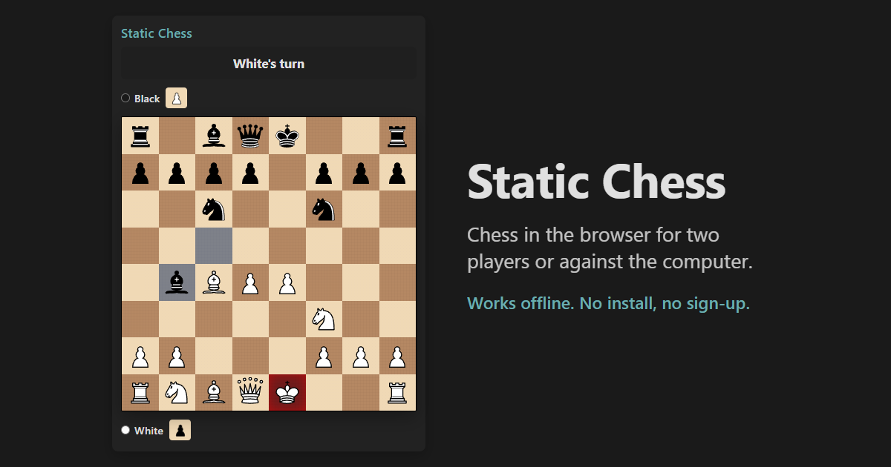
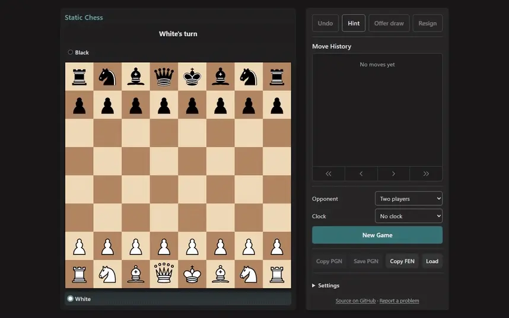
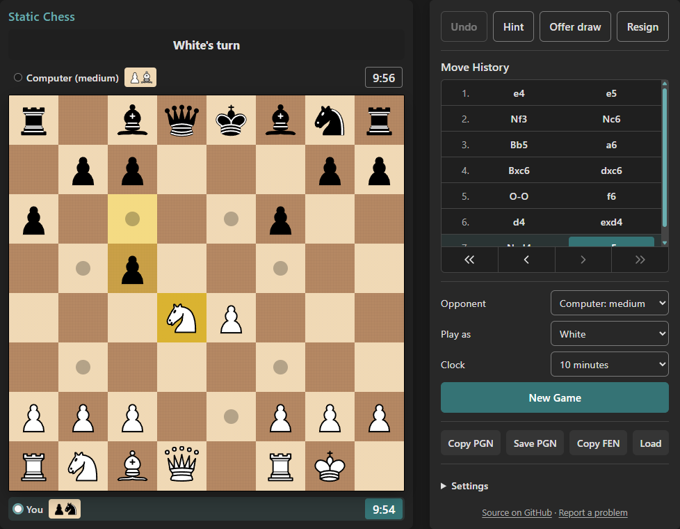
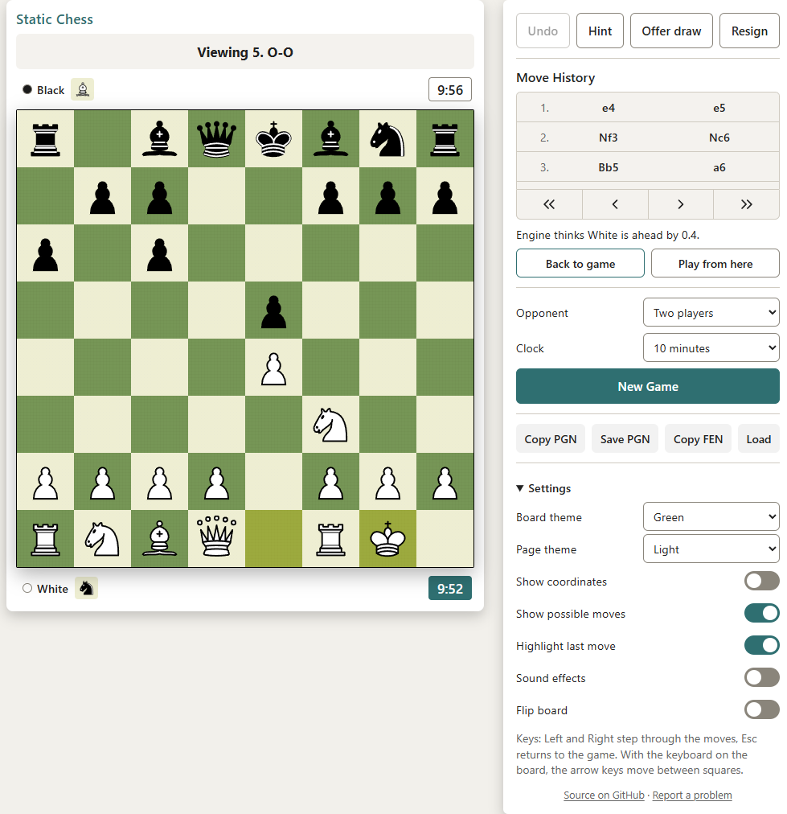
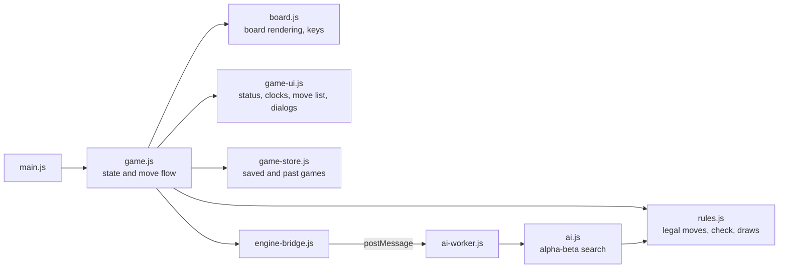

<div align="center">

<a href="https://tmhsdigital.github.io/Static_Chess/">
  
</a>

<h3>Chess in the browser, for two players or against the computer.<br>No frameworks, no runtime dependencies, no build step.</h3>

<p>
  <a href="https://tmhsdigital.github.io/Static_Chess/"></a>
  <a href="https://github.com/sponsors/TMHSDigital"></a>
</p>

<p>
  <a href="https://github.com/TMHSDigital/Static_Chess/actions/workflows/ci.yml"></a>
  <a href="https://github.com/TMHSDigital/Static_Chess/releases"></a>
  
  
  
  <a href="LICENSE"></a>
</p>

<p>
  <a href="https://tmhsdigital.github.io/Static_Chess/"><b>Play</b></a> ·
  <a href="#features"><b>Features</b></a> ·
  <a href="#quick-start"><b>Quick start</b></a> ·
  <a href="#keyboard-shortcuts"><b>Keyboard</b></a> ·
  <a href="#how-it-works"><b>How it works</b></a> ·
  <a href="#contributing"><b>Contributing</b></a> ·
  <a href="#support-the-project"><b>Sponsor</b></a>
</p>

</div>

---

<p align="center">
  
  <br>
  <sub>Playing the computer: four opening moves, a hint, then a look back through the game.</sub>
</p>

## Why Static Chess

|                                                                                                                                           |                                                                                                                            |                                                                                                                                  |
| :---------------------------------------------------------------------------------------------------------------------------------------- | :------------------------------------------------------------------------------------------------------------------------- | :------------------------------------------------------------------------------------------------------------------------------- |
| **The full rules.** Castling, en passant, promotion, check, mate, stalemate, and every draw rule, checked against published perft counts. | **A computer opponent.** Three levels, searched in a Web Worker so the board never freezes while it thinks.                | **Offline and installable.** After the first visit it runs with no connection, and it can be installed as an app.                |
| **Game review.** Step through any game, read what the engine makes of each position, and play on from any move.                           | **Keyboard and screen reader friendly.** The board is an ARIA grid, every move is announced, and `?` lists every shortcut. | **Nothing to install.** Open `index.html`. No framework, no bundler, no runtime packages: about 7,000 lines of plain JavaScript. |

## Features

<table>
<tr>
<td valign="top" width="50%">

**Playing**

- Two players on one device, or the computer at **easy**, **medium** or **hard**, as White, Black or a random side
- Click or drag pieces; legal moves, the last move and a king in check are highlighted
- Promotion chooser for queen, rook, bishop or knight
- **Chess clock** with five time controls (1, 3+2, 5, 10 and 15+10), warnings at 20 and 10 seconds
- **Undo** and **Redo** (off on the clock), **Resign**, **Offer draw**
- **Hint** shows the engine's move without playing it

</td>
<td valign="top" width="50%">

**Reviewing**

- Move list in standard algebraic notation; click any move to see the position
- Step buttons, and a **Play** button that runs through the game one move a second
- The engine's opinion of each position, in words ("White is ahead by 1.3")
- After a game, moves that lost a pawn and a half or more are marked **?**
- **Play from here** continues from any earlier position; the original game is kept
- Captured pieces and the material lead beside each player

</td>
</tr>
<tr>
<td valign="top">

**Saving and sharing**

- The game, with its undo history, survives a reload (`localStorage`)
- The last **20 games** are kept under Past games
- **PGN**: copy, save as a file, load by pasting or opening a `.pgn`
- **FEN**: copy the position, or start from a pasted one
- **Copy link** gives an address that opens the game for anyone

</td>
<td valign="top">

**Looks and access**

- Four board themes (Classic, Green, Blue, High contrast); dark, light or system page theme
- Coordinates, move hints, last-move highlight, sound and board flip in Settings
- Full keyboard play, screen reader announcements, reduced motion respected
- Responsive layout from phones to wide screens
- Optional synthesized sound effects

</td>
</tr>
</table>

<p align="center">
  
  &nbsp;
  
  <br>
  <sub>On the clock against the computer (left); reviewing a game in the light theme with Settings open (right).</sub>
</p>

## Quick start

**Play online:** [tmhsdigital.github.io/Static_Chess](https://tmhsdigital.github.io/Static_Chess/). Nothing to sign up for.

**Run it locally:**

```bash
git clone https://github.com/TMHSDigital/Static_Chess.git
cd Static_Chess
# then open index.html in a browser
```

Opening the file directly is enough to play. Offline mode and installing as an app need the page served over http(s), so for those use any static server:

```bash
npx serve .              # or: python -m http.server
```

**Host your own copy:** fork the repo and turn on GitHub Pages (Settings → Pages → Deploy from branch `main`, folder `/ (root)`). Any static host works; there is nothing to build. `_config.yml` keeps docs, tests and tooling out of the published site, so a new top-level file that is not part of the game belongs on that list.

## Keyboard shortcuts

Press <kbd>?</kbd> in the game to see this list. The panel is built from the same table the key handlers read, so it is always up to date.

| Where        | Keys                                                                         | Action                                        |
| :----------- | :--------------------------------------------------------------------------- | :-------------------------------------------- |
| Board        | <kbd>←</kbd> <kbd>↑</kbd> <kbd>→</kbd> <kbd>↓</kbd>                          | Move between squares                          |
| Board        | <kbd>Enter</kbd> / <kbd>Space</kbd>                                          | Pick up or move a piece                       |
| Moves        | <kbd>←</kbd> / <kbd>→</kbd>                                                  | Previous / next move                          |
| Move History | <kbd>Home</kbd> / <kbd>End</kbd>                                             | Starting position / latest move               |
| Moves        | <kbd>Esc</kbd>                                                               | Return to the live game                       |
| Game         | <kbd>Ctrl</kbd>+<kbd>Y</kbd> / <kbd>Ctrl</kbd>+<kbd>Shift</kbd>+<kbd>Z</kbd> | Redo an undone move (<kbd>Cmd</kbd> on a Mac) |
| Promotion    | Arrow keys / <kbd>Tab</kbd>                                                  | Move between the pieces to choose             |
| Dialogs      | <kbd>Esc</kbd>                                                               | Close a dialog or cancel a promotion          |
| Anywhere     | <kbd>?</kbd>                                                                 | Open the keyboard shortcuts                   |

## How it works



- **Rules as pure functions.** `rules.js` generates legal moves and detects check, mate and draws without touching the page, and the tests check it against published perft counts.
- **The engine runs off the main thread.** `ai.js` is an alpha-beta search with a quiescence search for captures. Easy looks one half-move ahead and sometimes blunders. Medium looks two ahead. Hard deepens iteratively, up to eight half-moves, for about a second. It runs in a Web Worker, and on the page if no worker is available.
- **One direction of data.** `game.js` owns the state and tells `board.js` and `game-ui.js` what to show in plain values. Neither of them changes the game.
- **Offline by design.** `sw.js` caches the app files on first visit, and `manifest.webmanifest` makes it installable.

The full picture is in [docs/ARCHITECTURE.md](docs/ARCHITECTURE.md).

<details>
<summary><b>Project structure</b></summary>

```
Static_Chess/
├── index.html, 404.html     # The page, and GitHub Pages' not-found page
├── sw.js                    # Service worker: the offline copy
├── manifest.webmanifest     # Makes the page installable
├── _config.yml              # What GitHub Pages leaves out of the site
├── css/                     # style.css, board.css, pieces.css
├── js/
│   ├── config.js            # Settings, time controls, themes, key bindings
│   ├── rules.js             # Rules of chess, no DOM
│   ├── pieces.js, utils.js  # Piece definitions and helpers
│   ├── game.js              # The live game: state, move flow, undo, saving
│   ├── board.js, drag.js    # Board rendering, keyboard, drag and drop
│   ├── game-ui.js           # Status, buttons, clocks, move list, dialogs
│   ├── promotion.js         # Promotion chooser
│   ├── notation.js          # SAN, PGN and FEN
│   ├── clock.js, review.js  # Clock rules; engine scores in words
│   ├── saved-game.js, game-store.js  # Checking and storing games
│   ├── engine-bridge.js     # Talks to the engine
│   ├── ai.js, ai-worker.js  # The computer opponent and its worker
│   └── main.js              # Start-up
├── assets/                  # Piece SVGs, icons, screenshots, social card
├── tests/                   # Jest unit and integration tests, Playwright smoke tests
├── docs/                    # Architecture, roadmap, release process
└── releases/                # Release notes
```

</details>

## Development

Node is only needed for the dev tooling (22.22.2+ on the 22 line, or 24.15+). The game itself has no dependencies.

```bash
npm ci
npm run lint            # ESLint, no warnings allowed
npm run format          # Prettier check
npm test                # Jest unit and integration tests (jsdom)
npm run coverage        # The same, with coverage, as CI runs it
npm run test:browser    # Chromium smoke tests with Playwright
```

CI runs all of these on Node 22 and 24 for every push and pull request. See [CONTRIBUTING](.github/CONTRIBUTING.md) for the conventions, including what to update when a file is added (for example the service worker's file list).

## Roadmap

Next up: a stronger engine (faster move generation, a transposition table), deeper game analysis, named saved games, and more difficulty levels. See [docs/ROADMAP.md](docs/ROADMAP.md) and the [CHANGELOG](CHANGELOG.md).

## Contributing

Contributions are welcome, from typo fixes to engine work.

1. Look at the [open issues](https://github.com/TMHSDigital/Static_Chess/issues). Many include the files involved and acceptance criteria.
2. Fork, branch, and make your change with tests.
3. Run `npm run lint && npm run format && npm run coverage`.
4. Add a line to `CHANGELOG.md` under _Unreleased_ if a player would notice the change, then open a pull request.

For larger changes, open an issue first. Please follow the [Code of Conduct](.github/CODE_OF_CONDUCT.md), and report vulnerabilities privately as described in the [Security Policy](.github/SECURITY.md).

## Support the project

Static Chess is free, has no ads and no tracking. If you enjoy it, you can help keep it maintained:

<p>
  <a href="https://github.com/sponsors/TMHSDigital"></a>
</p>

Starring the repo, reporting a bug, or sharing a game link helps too.

## License

[Apache License 2.0](LICENSE) © TMHSDigital
